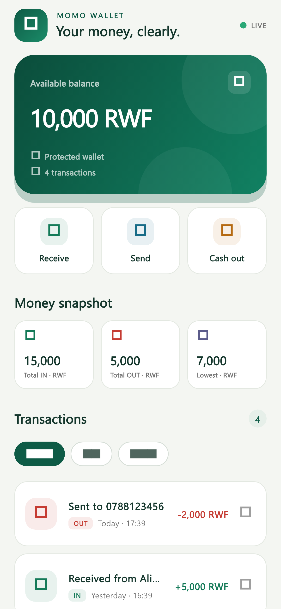
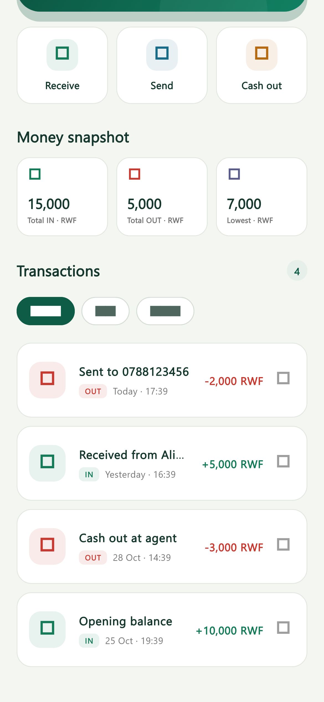
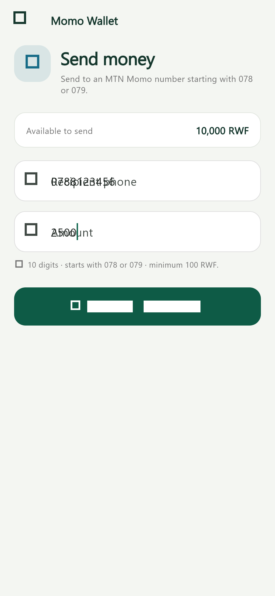
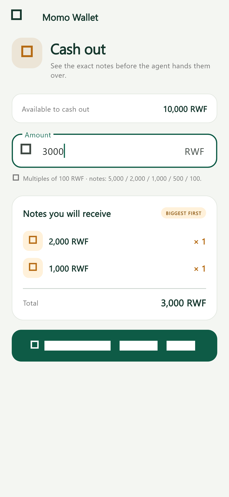
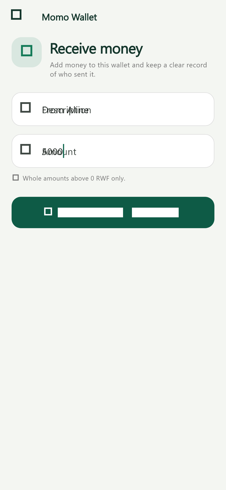
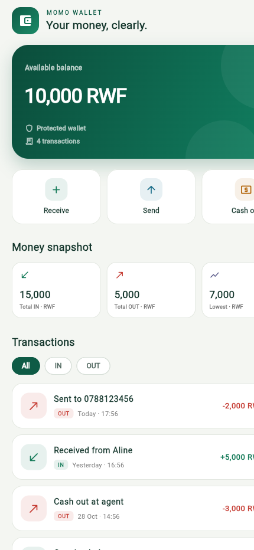

# Momo Wallet

**Week 2 · Session 4 — Mini Project Building**

Mobile Programming · Innovation Center

Momo Wallet is a Flutter wallet built around one promise: the balance must never lie. Money comes in, goes out to friends, and is cashed out at an agent. Every action is checked before it changes anything, every total is calculated from the transaction history, and the screen always shows the current data.

**Project chosen:** MoMo Wallet — built on Labs 3, 2 and 6.

## Screenshots

| Wallet | Transactions |
| --- | --- |
|  |  |

| Send money | Cash out |
| --- | --- |
|  |  |





## Features

- A custom forest-green wallet design with its own balance card, quick actions, statistics cards, icons and typography.
- Starts with **10,000 RWF** and four sample transactions: an opening balance of 10,000 IN, a 3,000 cash out, 5,000 received, and 2,000 sent.
- Newest-first transaction history showing the description, date, signed amount and a clear green **IN** or red **OUT** badge.
- Filters for **All**, **IN** and **OUT** without changing the real transaction list.
- **Receive money** screen: a description and a whole amount above 0 RWF.
- **Send money** screen: a 10-digit phone number starting with 078 or 079, and at least 100 RWF. The transaction is recorded as `Sent to 0788123456`.
- **Cash out** screen: an amount that is a multiple of 100 RWF, a biggest-first note breakdown before confirming, and a transaction recorded as `Cash out`.
- Every OUT is refused when it is bigger than the current balance: `Insufficient balance.`
- Statistics calculated from the whole history: total IN, total OUT and the lowest balance ever reached.
- Delete any transaction from its menu, with **Undo**. A delete is refused if the balance would go below 0 at any point in the history.
- Separate screens for each action, with the new transaction passed back to the wallet with `Navigator.pop`.
- Friendly empty states for an empty history or an empty filter.
- Rules and calculations live in `lib/logic/wallet_logic.dart`, outside `build`.

## How the data stays correct

The wallet's source of truth is a single `List<WalletTransaction>`. The balance and every statistic are calculated from that list, never stored twice. A form screen validates all of its input, creates the transaction, and only returns it when the user succeeds. `WalletScreen` then adds it and rebuilds. Deleting uses the transaction object rather than a list index, so filters cannot delete the wrong row.

Cash out notes use the agent's denominations: **5,000, 2,000, 1,000, 500 and 100 RWF**. For example, 23,700 RWF becomes `5,000 × 4`, `2,000 × 1`, `1,000 × 1`, `500 × 1`, `100 × 2`.

## Project structure

```text
lib/
  main.dart                         app theme and entry point
  models/wallet_transaction.dart    model class and sample history
  logic/wallet_logic.dart           validation, history, statistics, notes
  screens/
    wallet_screen.dart              dashboard and transaction history
    receive_money_screen.dart       receive form
    send_money_screen.dart          send form
    cash_out_screen.dart            note preview and confirmation
  widgets/
    form_screen_scaffold.dart       shared form layout and error banner
    transaction_tile.dart           transaction row and delete menu
```

## Run it

```bash
flutter pub get
flutter run
```

## Tests

```bash
flutter analyze
flutter test
```

The tests cover phone, amount and cash-out validation, note breakdown, sample statistics, the delete guard, comma formatting, the wallet launch screen, a refused send and a successful send, and the cash-out rejection and confirmation flows.

## Think answers

### Why must every check happen before any money moves? What would go wrong if one check came after?

Because a wallet action is all or nothing. If the balance changed before a later check failed, the app could take 1,000 RWF from the user and still show “phone number must start with 078” — with no valid transaction to explain the missing money. My screens run every rule first and return early on the first failure. Only after all checks pass do they create a transaction and hand it back to the wallet, so a refusal changes nothing.

### Your lowest-balance statistic needs a starting value. What did you start it at, and why not 0?

I start the running balance at 0 but the lowest recorded value at the first balance after the first chronological transaction — not 0 itself. If 0 were always included, every wallet that never went negative would report 0 as its lowest balance, hiding the real low of 7,000 RWF in the sample history. The sample goes: opening 10,000 → cash out 3,000 leaves 7,000 (the low) → received 5,000 leaves 12,000 → sent 2,000 leaves 10,000. With no transactions at all, the card shows 0.


